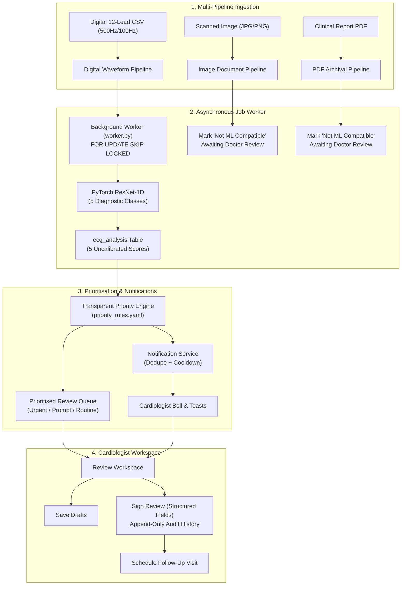

# MediGuard AI – Technical & Clinical Architecture

> **"Intelligent Cardiac Monitoring. Smarter Clinical Decisions."**

---

## 1. High-Level Clinical Flow

MediGuard AI is designed as a **hospital cardiology clinical decision-support prototype** focused on post-angioplasty, coronary stent, and myocardial infarction (MI) patient monitoring. Doctors own 100% of the diagnostic responsibility.

---

## 2. Separate Pipelines Architecture (Rule 4 Compliance)

1. **Digital Waveform Pipeline (`.csv`)**:
   - Parses 12-lead digital channels ($I$, $II$, $III$, $aVR$, $aVL$, $aVF$, $V_1$–$V_6$).
   - Validates duration ($\ge 5.0\text{s}$, standard $10.0\text{s}$ at $100\text{ Hz}$ or $500\text{ Hz}$).
   - Enqueues job in `jobs` table. Background worker invokes PyTorch `ResNet-1D` model.
   - Computes 5 uncalibrated experimental scores: `NORM`, `MI`, `STTC`, `CD`, `HYP`.
   - Renders interactive signals via Chart.js.

2. **Image Pipeline (`.jpg`, `.jpeg`, `.png`)**:
   - Stores securely in private bucket `ecg-files`.
   - Generates thumbnail and verifies resolution.
   - Status marked `not_compatible_ml` (*"Not compatible with ML analysis – awaiting cardiologist review"*).
   - **Zero OCR interpretation. Zero fabricated scores.**

3. **PDF Document Pipeline (`.pdf`)**:
   - Stores clinical vector PDF in private storage.
   - Generates expiring signed URL (valid for 15 minutes, never public).
   - Status marked `not_compatible_ml` for direct physician reading.

---

## 3. Rule-Based Prioritization Engine (`priority_rules.yaml`)

Prioritization is rule-based, fully transparent, and human-auditable:

* **Urgent Review Criteria**:
  - Clinician-assigned urgency level is `stat_emergency` or `urgent`.
  - Acute symptoms recorded by staff (`chest_pain`, `syncope`, `acute_dyspnea`).
  - Recent angioplasty / PCI within 14 days.
  - Previous validated findings of Acute STEMI or Ventricular Tachycardia.
* **Prompt Review Criteria**:
  - Recent PCI within 30 days.
  - Active coronary stent history ($\ge 1$ stent).
  - Post-procedure follow-up appointment is overdue.
  - Previous validated findings of NSTEMI or Atrial Fibrillation.
* **Non-Negotiable ML Safety Rule**:
  - Elevated ML scores ($\ge 0.65$ for `MI`, `STTC`, `CD`) **only add an informative reason** (*"Experimental model score elevated for MI (0.85) – for clinician attention"*).
  - **An ML score can NEVER create or escalate a patient to "Urgent" on its own.**
  - **An ML score can NEVER lower an existing urgency level.**

---

## 4. Notification System & Deduplication

* **Notification Types**: `new_upload`, `analysis_complete`, `concerning_finding_review`, `follow_up_due`, `emergency_flag`.
* **Deduplication Key**: `hash(type + entity_id + recipient_id)` with a 300-second cooldown window.
* **Rule 9 Exception**: `emergency_flag` notifications **bypass deduplication and cooldown completely** and are **never suppressed**.
* **Daily Follow-Up Scheduler**: Powered by `APScheduler`, running daily to detect overdue patient visits and alert attending cardiologists.

---

## 5. Cardiologist Review Workspace & Audit Trail

* **Structured Findings**:
  - Heart Rhythm: *Normal Sinus, Sinus Brady/Tachy, AFib, AFlutter, VT (STAT), Junctional*
  - ST/T Wave: *Normal, ST Elevation (V2-V4 Anteroseptal), ST Elevation (Inferior), ST Depression, T-Inversion*
  - Conduction: *Normal AV, LBBB, RBBB, 1st Degree AV Block, 3rd Degree Complete Block*
  - Overall Impression & Recommendation
  - Agreement with Model: *Agreed, Partially Agreed, Disagreed, Not Applicable*
  - Urgency Assignment: *Routine, Urgent, STAT Emergency*
* **Draft Support**: Allows saving in-progress interpretations (`POST /api/reviews/draft`).
* **Append-Only History**: Signed reviews are immutable. Amendments increment version numbers (`version 1`, `version 2`), preserving an unbroken clinical audit trail.
* **Direct Follow-up Scheduling**: Seamlessly injects a scheduled check-up into the patient's record upon sign-off.
